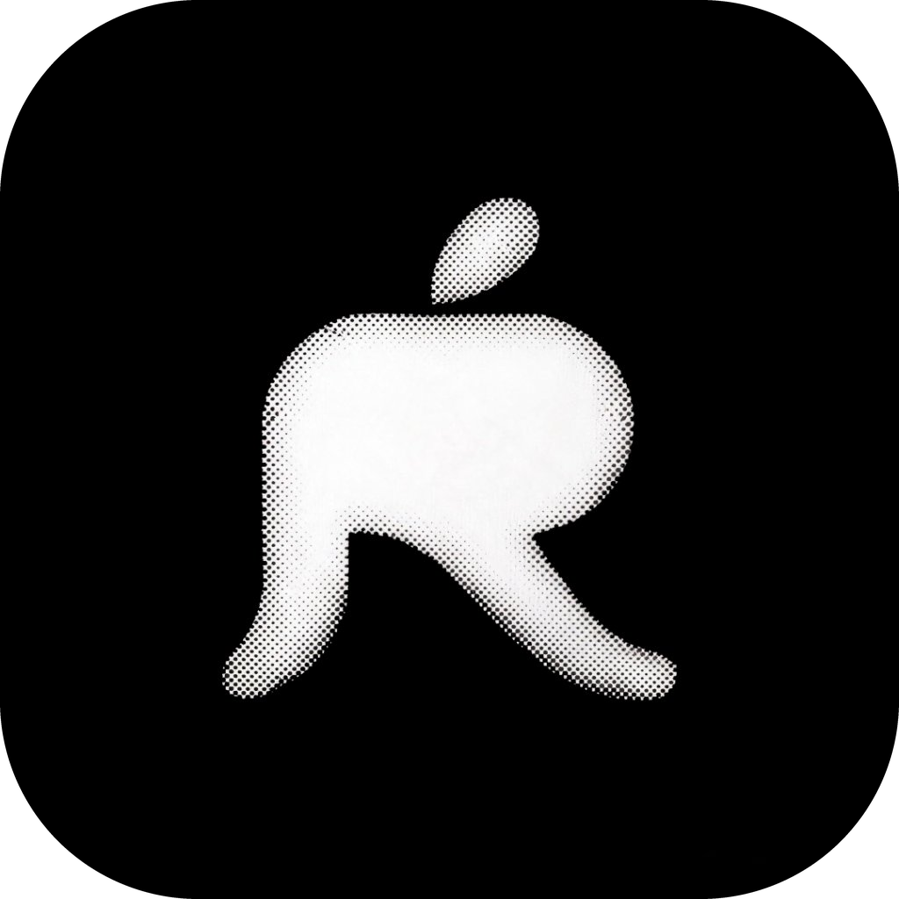
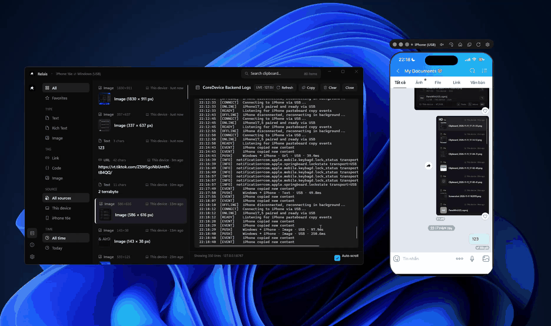
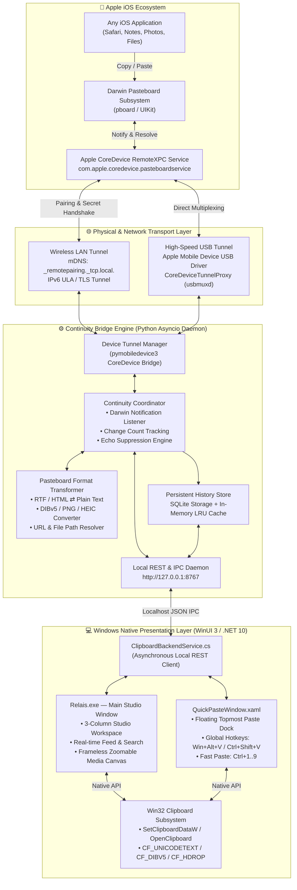

<div align="center">



# Relais

### Native iPhone ⇄ Windows Universal Clipboard Synchronizer

[](https://github.com)
[](https://microsoft.com)
[](https://apple.com)
[](https://dotnet.microsoft.com)
[](https://github.com)
[](LICENSE)

<br/>

**Relais** brings genuine, instantaneous Apple Universal Clipboard capabilities to Windows.  
Copy text, URLs, high-resolution images, and documents on your iPhone — press `Ctrl + V` on Windows. Copy on Windows — paste immediately on iPhone.

**No iOS companion app · No Shortcuts · No Back Tap · No Share Sheet · No Jailbreak**

<br/>



</div>

---

## Highlights

- ⚡ **Zero Interaction Required**: Copy anything on iPhone; Windows clipboard updates automatically in milliseconds.
- 🔄 **True Bidirectional Synchronization**: Copy on Windows and paste directly into iOS apps (`Notes`, `Safari`, `Messages`, `Photos`).
- 📡 **Dual Continuity Transport**: Operates seamlessly over wireless LAN (`_remotepairing._tcp.local.`) or high-speed wired USB (`CoreDeviceTunnelProxy`).
- 🎨 **Anti-AI-Slop Monochrome Interface**: Precision-crafted WinUI 3 interface in pure black and white. No fake cards, no bloated chips, no distracting saturated colors.
- 🔍 **Interactive Media Inspector**: Frameless viewport with smooth mouse-wheel zooming (`0.2×` to `5.0×`) and double-tap zoom for high-res images.
- ⚡ **Floating Quick Paste Overlay**: Press `Win + Alt + V` or `Ctrl + Shift + V` from any app to access your clipboard history with instant number shortcuts (`Ctrl + 1..9`).
- 🛡️ **Native Apple Security**: Built entirely on Apple's authenticated **CoreDevice RemoteXPC** protocol with mutual TLS and tunnel encryption.

---

## Architectural Layers

Relais operates on a modular, decoupled architecture bridging Apple's Darwin RemoteXPC subsystem and the Win32 / Windows App SDK ecosystem:



---

## Clipboard Formats & Types

Relais handles native format conversions bidirectionally without loss of fidelity:

| Format / UTI | iOS Representation | Windows Clipboard Mapping | Preview in Relais |
| :--- | :--- | :--- | :--- |
| **Plain Text** | `public.utf8-plain-text` | `CF_UNICODETEXT` (UTF-16LE) | Clean document viewer with line height & selection |
| **Web Link** | `public.url` | `UniformResourceLocatorW` + Text | Large domain banner + Cascadia Code box + Open Link |
| **Source Code** | `public.source-code` | `CF_UNICODETEXT` | Monospace editor view with syntax indentation |
| **Rich Text / HTML** | `public.html`, `public.rtf` | `HTML Format` + UTF-8 Plain Text | Rendered text with HTML entity resolution |
| **Images** | `public.png`, `public.jpeg`, `public.heic` | `CF_DIBV5`, `PNG`, `CF_BITMAP` | Frameless canvas with mouse scroll zoom (0.2×–5.0×) |
| **Files** | `public.file-url`, `com.apple.archive` | `CF_HDROP` (HDROP file descriptors) | Extension badge, filename, and quick open button |

---

## Keyboard Shortcuts

| Shortcut | Scope | Action |
| :--- | :--- | :--- |
| <kbd>Win</kbd> + <kbd>Alt</kbd> + <kbd>V</kbd> | Global | Open / Close floating **Quick Paste** popup anywhere |
| <kbd>Ctrl</kbd> + <kbd>Shift</kbd> + <kbd>V</kbd> | Global | Alternative shortcut to open Quick Paste popup |
| <kbd>Ctrl</kbd> + <kbd>1</kbd> .. <kbd>9</kbd> | Quick Paste | Instantly paste item #1 through #9 into the active application |
| <kbd>C</kbd> | Main Window | Copy selected item to Windows clipboard |
| <kbd>S</kbd> | Main Window | Push selected item to iPhone pasteboard immediately |
| <kbd>F</kbd> | Main Window | Toggle Favorite / Pinned status |
| <kbd>Del</kbd> | Main Window | Delete selected item from clipboard history |
| <kbd>Ctrl</kbd> + <kbd>F</kbd> | Main Window | Focus search input bar |
| <kbd>Double Click</kbd> | Media Viewer | Toggle image zoom between `1.0×` and `2.0×` |
| <kbd>Scroll Wheel</kbd> | Media Viewer | Smoothly zoom image in / out (`0.2×` – `5.0×`) |

---

## Installation & Setup

### Option 1: Standalone MSI Installer (Recommended)
1. Download **`Relais.msi`** from the [Releases](https://github.com) page.
2. Run the installer. It installs Relais into `Program Files\Relais` and creates a Start Menu shortcut with the custom logo.
3. Connect your iPhone via USB once to pair Wi-Fi synchronization.

### Option 2: Build from Source

#### Prerequisites
* Windows 10 (version 19041+) or Windows 11
* [.NET 10.0 SDK](https://dotnet.microsoft.com/download/dotnet/10.0)
* [Python 3.10+](https://www.python.org/) with Developer Mode enabled on iPhone
* iTunes for Windows or Apple Devices app (for Apple Mobile Device Support drivers)

#### Setup Steps
```powershell
# 1. Clone repository
git clone https://github.com/your-username/UniversalClipboard.git
cd UniversalClipboard

# 2. Install Python dependencies
pip install -r requirements.txt

# 3. Build Release binary
dotnet build -c Release

# 4. Run Relais
.\bin\x64\Release\net10.0-windows10.0.19041.0\win-x64\Relais.exe
```

#### Packaging MSI Installer
```powershell
# Publish output
dotnet publish -c Release -o dist\Relais

# Build standalone MSI with WiX Toolset
wix build -arch x64 -o Relais.msi Package.wxs
```

---

## Pairing iPhone via Wi-Fi (One-time Setup)

1. Connect iPhone to PC via USB cable.
2. Ensure **Developer Mode** is enabled on iPhone (*Settings → Privacy & Security → Developer Mode*).
3. Trust the computer when prompted on your iPhone.
4. Launch **Relais** and click **Continuity Setup** in the left rail.
5. Click **Pair Wi-Fi over USB**. Once paired, disconnect the USB cable — Relais will now synchronize over Wi-Fi automatically.

---

## Technical Specifications

- **IPC Port**: `127.0.0.1:8767`
- **mDNS Service**: `_remotepairing._tcp.local.`
- **Darwin Service**: `com.apple.coredevice.pasteboardservice`
- **Darwin Notification**: `com.apple.pasteboard.notify.changed`
- **UI Framework**: WinUI 3 (Windows App SDK 1.6) with native Mica Alt / Acrylic backdrop
- **Color Model**: Strict Grayscale / Pure Monochrome (`#0A0A0A` / `#121214` / `#1E1E24` / `#FFFFFF`)

---

## License

Distributed under the MIT License. See [`LICENSE`](LICENSE) for more information.

<div align="center">
<sub>Crafted with precision for seamless Apple ⇄ Windows interoperability.</sub>
</div>
